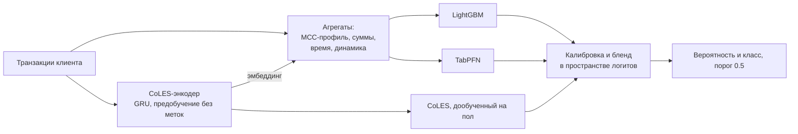
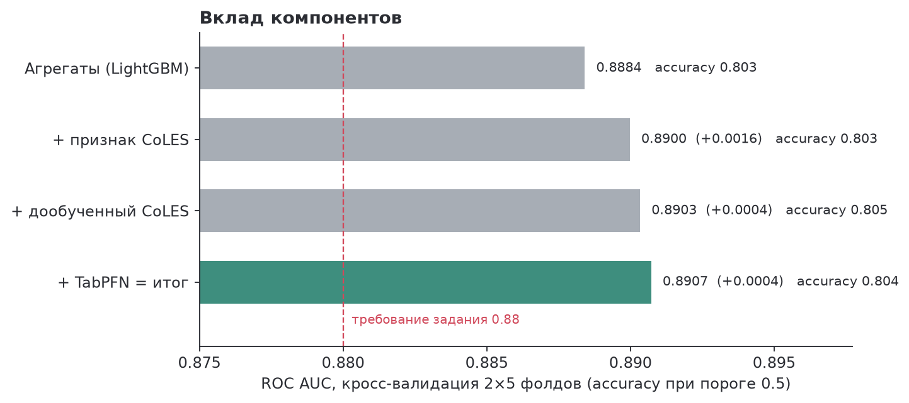
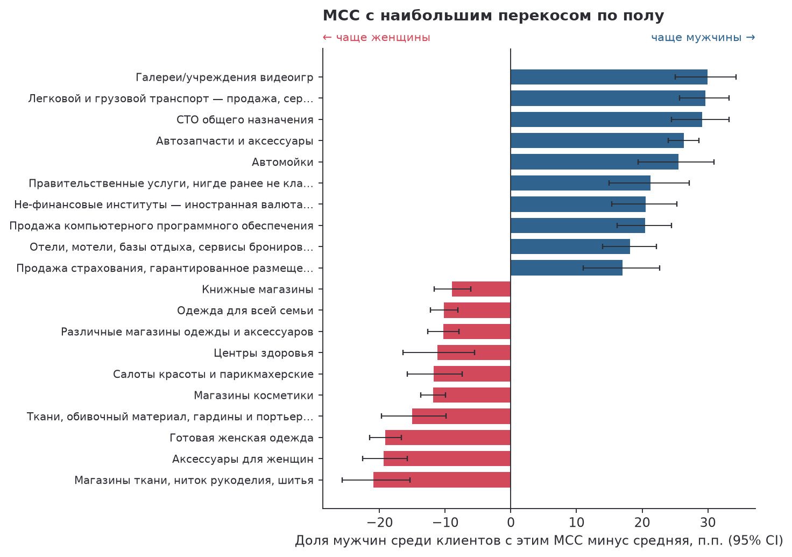

# Пол клиента по карточным транзакциям

[](https://github.com/Eltralo/gender-prediction/actions/workflows/ci.yml)

Бинарная классификация пола клиента банка по последовательности его транзакций (MCC, тип операции, сумма, время, терминал) на датасете [`mks-logic/gender_prediction`](https://huggingface.co/datasets/mks-logic/gender_prediction).

| | ROC AUC | Accuracy |
|---|---|---|
| Кросс-валидация на train + val, 2 × 5 фолдов | 0.8907 ± 0.0121 | 0.8044 ± 0.0132 |
| **Test**, 1 680 клиентов, 95% CI | **0.898** [0.883; 0.913] ✓ | **0.811** [0.793; 0.830] ✓ |
| Требование задания | > 0.88 | > 0.80 |
| Бейзлайн задания (RandomForest, 4 признака) | 0.574 | 0.558 |



```bash
make setup      # окружение conda gender_hw + пакет
make evaluate   # метрики на test по финальной модели (артефакты из GitHub Release)
make train      # полный пересчёт: признаки, CoLES, кросс-валидация, финальные модели (~25 мин на GPU)
```





## Решение

1. **Агрегаты клиента** (~700 признаков без меток; вместе с признаками с метками — 719): активность, суммы расходов и поступлений, доли операций и трат по MCC и типам операций, средний чек по MCC, распределение по часам (время 00:00:00 трактуется как неизвестное) и дням недели, терминалы, концентрация трат, затухающие средние, автокорреляция, окна последних 30/90/180 дней. Словари категорий фиксируются по train, поэтому колонки одинаковы на любом сплите.
2. **Признаки с метками** — target encoding MCC и типов операций, логистическая регрессия по TF-IDF профилей и по эмбеддингу CoLES — считаются только внутри обучения: для обучающих клиентов out-of-fold по внутренним фолдам, для новых — по статистикам обучающих.
3. **CoLES**: GRU-энкодер (1024) над транзакциями предобучается контрастно без меток на клиентах train и val, затем даёт эмбеддинг-признак для бустинга и дообучается на пол.
4. **Модели и бленд**: LightGBM, дообученный CoLES и TabPFN v2 (300 признаков, отобранных внутри обучения). Скоры калибруются (Platt), бленд — взвешенная сумма логитов, веса подбираются по out-of-fold предсказаниям. Вероятности откалиброваны, поэтому порог 0.5 оптимален для accuracy без подбора.
5. **Валидация**: stratified 5-fold × 2 повтора на train + val; число итераций бустинга, калибровка и веса бленда для каждого фолда подбираются по остальным фолдам. Финальные модели обучаются на всех 6 720 размеченных клиентах. Test открыт один раз, на зафиксированной модели.

Подробности, вклад компонентов и проверенные, но не вошедшие идеи — в [REPORT.md](REPORT.md); рассказ с кодом и графиками — в [notebooks/pred_gen_tr.ipynb](notebooks/pred_gen_tr.ipynb).

## Запуск

**Окружение.** `make setup` создаёт conda-среду `gender_hw` из [environment.yml](environment.yml) (Python 3.11, PyTorch 2.11 с CUDA 12.8) и ставит пакет. Для CPU уберите из `environment.yml` строку `--extra-index-url`.

**Данные** скачиваются с Hugging Face в `data/` автоматически (`python -m gender_pred.cli data`).

**Флаги пересчёта** — в [configs/default.yaml](configs/default.yaml):

| Флаг | По умолчанию | Действие |
|---|---|---|
| `retrain` | `false` | `false`: финальные модели из `artifacts/` (см. «Артефакты» ниже); `true`: полный пересчёт |
| `retrain_tabular`, `retrain_seq` | `null` (= `retrain`) | пересчёт по частям: табличные модели и бленд / энкодер CoLES |

**Артефакты.** Финальные модели (25 МБ) лежат архивом `artifacts.zip` в [GitHub Release v1.0.0](https://github.com/Eltralo/gender-prediction/releases/tag/v1.0.0). Репозиторий приватный, поэтому для скачивания нужен доступ; источники перебираются по порядку:

1. уже распакованный `artifacts/` или архив, положенный вручную в `artifacts/artifacts.zip` (скачайте его со страницы релиза);
2. `artifacts_release.url` в конфиге — публичная ссылка на архив, если задана;
3. `gh release download` — если `gh` установлен и выполнен `gh auth login`;
4. GitHub API с токеном из `GH_TOKEN` или `GITHUB_TOKEN` (право чтения репозитория) — без `gh`.

Если ни один источник недоступен, запуск останавливается с сообщением и этими вариантами; без артефактов модель можно обучить заново (`make train`).

В ноутбуке тот же переключатель — `RETRAIN` в первой ячейке с кодом. Все гиперпараметры и сиды — в том же YAML.

**Время** (RTX 5090 Laptop / 24 ядра CPU):

| | GPU | CPU |
|---|---|---|
| `make evaluate`, ноутбук с `RETRAIN = False` | ~2 мин | ~40 мин (эмбеддинги GRU и TabPFN на CPU) |
| `make train` (полный пересчёт) | ~25 мин | нецелесообразно: обучение GRU на CPU ≈ сутки |

Метрики выше получены на GPU; на CPU из-за численных различий GRU и TabPFN они могут отличаться в третьем-четвёртом знаке (проверено: AUC 0.8979, accuracy 0.8125 против 0.8113).

**Проверки**: `make test` — ruff и тесты на синтетике (CPU, < 1 мин): совпадение колонок между сплитами, независимость обучения от меток test, формы и диапазоны выходов, end-to-end прогон. `make figures` пересоздаёт графики из `results/`.

## Структура

```
configs/default.yaml        гиперпараметры, сиды, флаги пересчёта
src/gender_pred/
    data.py                 загрузка, конфиг, подготовка транзакций
    features.py             агрегаты клиента и признаки с метками
    sequence.py             CoLES: энкодер, предобучение, дообучение
    models.py               LightGBM, TabPFN, калиброванный бленд
    cv.py                   кросс-валидация, финальное обучение, метрики
    cli.py                  команды train / evaluate / figures
    plots.py                графики
notebooks/pred_gen_tr.ipynb ноутбук задания
results/                    метрики CV и test, вклад компонентов, важности
reports/figures/            графики
tests/                      pytest
```
