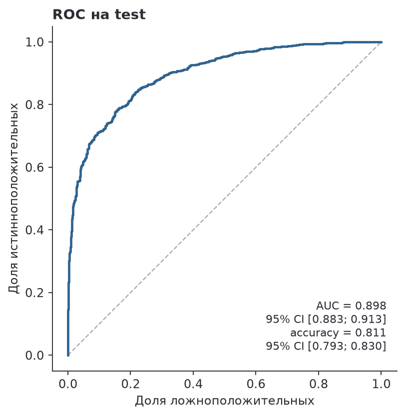
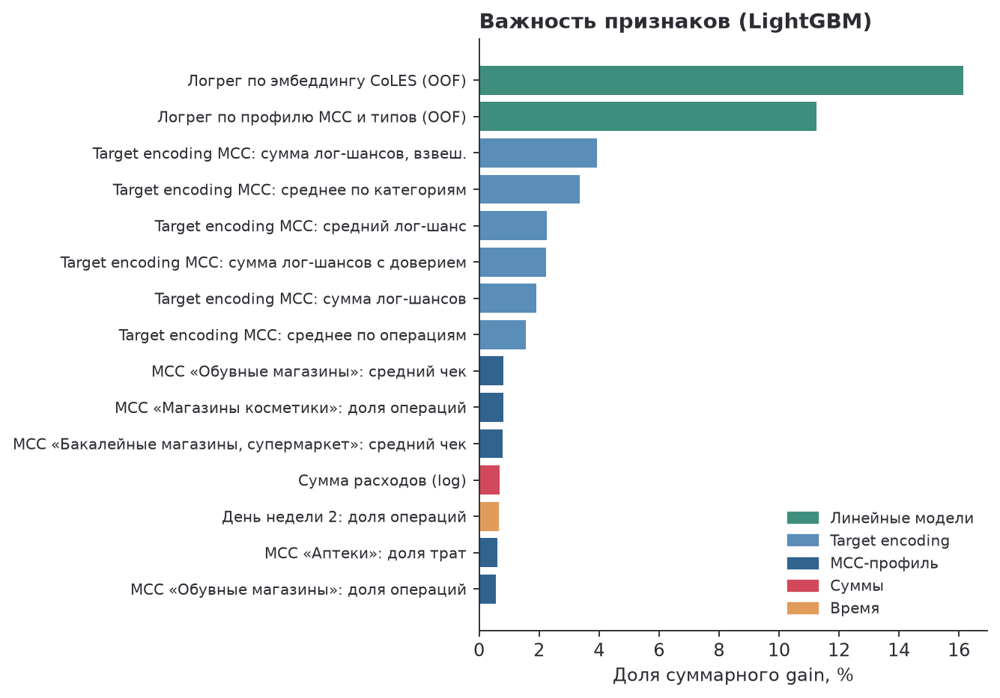

# Отчёт: пол клиента по транзакциям

**Итог.** Test (1 680 клиентов): ROC AUC **0.898** [0.883; 0.913], accuracy **0.811** [0.793; 0.830] — оба требования (AUC > 0.88, accuracy > 0.80) выполнены. Кросс-валидация на train + val: AUC 0.8907 ± 0.0121, accuracy 0.8044 ± 0.0132. Бейзлайн задания — AUC 0.574.

## Подход

Ансамбль из трёх моделей над общими признаками клиента:

- **LightGBM** на ~700 агрегатах (MCC-профиль, суммы, время, динамика, терминалы) и 20 признаках с метками (target encoding MCC и типов операций, логистическая регрессия по TF-IDF профилей и по эмбеддингу CoLES), посчитанных только внутри обучения;
- **CoLES**: GRU-энкодер транзакций, предобученный контрастно без меток на клиентах train и val и дообученный на пол;
- **TabPFN v2** на 300 признаках, отобранных по важности LightGBM внутри обучения.

Скоры калибруются по out-of-fold предсказаниям, бленд — взвешенная сумма логитов (веса 0.70 / 0.10 / 0.20), порог 0.5. Все решения приняты по кросс-валидации (stratified 5-fold × 2 повтора; число итераций, калибровка и веса для фолда подбираются по остальным фолдам). Финальные модели обучены на всех 6 720 размеченных клиентах; test открыт один раз.

## Гиперпараметры

Все — в [configs/default.yaml](configs/default.yaml). Ключевые параметры LightGBM:

| learning_rate | num_leaves | min_child_samples | feature_fraction | bagging_fraction | lambda_l2 | деревьев |
|---|---|---|---|---|---|---|
| 0.02 | 15 | 30 | 0.25 | 0.8 | 10 | вложенная ранняя остановка (≤ 3 000), в финале × 1.25 |

Число деревьев для фолда — по максимуму средней AUC-кривой остальных фолдов; CoLES — по эталонному конфигу gender из ptls-experiments, эпохи — по плато качества эмбеддинга; калибровка и веса бленда — вложенно по OOF. Вложенный тюнинг Optuna (50 trials на фолд) на внешних фолдах дал AUC −0.0015 ± 0.0031 к базовым параметрам (лучше в 2 из 5 фолдов) — не используется.

## Вклад компонентов (кросс-валидация, 10 фолдов)

| Шаг | ROC AUC | Accuracy |
|---|---|---|
| Агрегаты, LightGBM | 0.8884 ± 0.0112 | 0.8028 |
| + признак CoLES (логрег по эмбеддингу) | 0.8900 (+0.0016) | 0.8028 |
| + дообученный CoLES в бленде | 0.8903 (+0.0004) | 0.8053 |
| + TabPFN = итог | **0.8907** (+0.0004) | **0.8044** |

Основной сигнал — профиль трат по MCC: одна эта группа даёт AUC 0.874, остальные группы агрегатов по отдельности — 0.55–0.67, все вместе — 0.886. Test не отличается от train (adversarial validation: AUC 0.495), поэтому кросс-валидация репрезентативна. CoLES добавляет информацию о порядке операций, которой нет в агрегатах; каждое добавление проверялось парным сравнением по 10 фолдам (признак CoLES: +0.0016 ± 0.0018, прирост в 8 фолдах из 10).

| ROC на test | Важность признаков |
|---|---|
|  |  |

## Проверено и не вошло

- **Терминалы**: сглаженный target encoding `term_id` и логистическая регрессия по графу клиент–терминал — прирост в пределах шума (у медианного терминала один клиент).
- **XGBoost и CatBoost** (та же матрица и фолды): XGBoost вровень с LightGBM (AUC −0.0001 ± 0.0018), прирост в бленде в пределах шума (+0.00003) — оставили одну модель бустинга ради простоты; CatBoost хуже (−0.0047 ± 0.0027, 0/10 фолдов), вес 0. Тюнинг LightGBM через Optuna — см. «Гиперпараметры».
- **Дополнительные статистики** концентрации, ритма и дрейфа трат, усреднение сидов, TTA и предобучение CoLES на клиентах test (без меток) — в пределах шума.

## Ограничения

- **Шум test.** На 1 680 клиентах 95% интервал AUC ≈ ±0.015, accuracy ≈ ±0.019 — шире различий между сильными вариантами модели. Test выше CV на 0.007, что в пределах шума; ожидаемое качество модели — ближе к оценке CV.
- **Запас по accuracy небольшой**: на CV 0.804, в 4 из 10 фолдов ниже 0.80.
- **Объём для предобучения.** CoLES обучается на 6 720 последовательностях; в литературе на этой задаче он сильнее при большем числе неразмеченных клиентов.

## Что дальше

Больше неразмеченных последовательностей для предобучения CoLES; признак «круглых» сумм (суммы — исходные, умноженные на константу ≈ 2245.92, и 42.5% операций — целое число единиц; в одиночку сигнал слабый, AUC 0.52 на train); трансформер вместо GRU; мультизадачное дообучение (пол вместе с другими атрибутами клиента при наличии разметки); калибровка порога под бизнес-метрику вместо accuracy.
